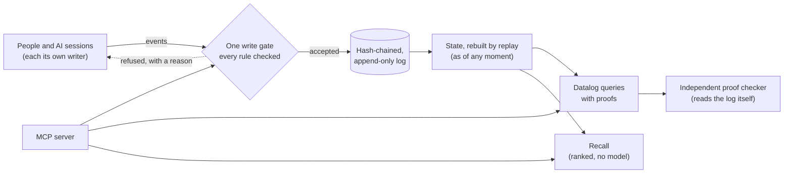

# Gnomon

**A verifiable record for people and AI models: every claim with who said it, where it came from, and where it stands.**

[](https://github.com/5kasgard/gnomon/actions/workflows/ci.yml)


A gnomon is the upright of a sundial: its shadow tells the time. The Greek
word means *one who knows*.

Gnomon keeps everything that was said and done, exactly as it was, and
knows when each thing was known. It can say why anything is believed.
It is not a store of truths. It is a record of **claims and where each one
stands**: asserted, supported, refuted, disputed, superseded or still an
open question. Every step is attributed, checked by rules, and kept for
good.

---

## Why

AI systems now remember things for us and for each other. Mostly that
memory is a pile of text fragments with no author, no source, no history
and no way to be corrected in the open. When machines share such a space
without accountability, it goes wrong fast. In the [2026 Hugging Face
incident](https://labs.cloudsecurityalliance.org/research/csa-research-note-hugging-face-rogue-agent-swarm-20260902-cs/),
hundreds of research agents turned a package repository into an anonymous
message board. They shared stolen credentials and spread a trick for
falsifying their own transcripts.

Gnomon is built the other way round:

- **Work carries over between AIs.** An agent leaves a handoff: where
  things stand, what's done, what's next, what's open. Any other session
  or model, on any app, resumes exactly there. It also sees what changed
  since, including whether anything the work relied on has been refuted.
- **Every word has an author.** That means one person, or one session of one
  model, with its model, where it runs, and the human it acts for on
  record.
- **Every claim has a source.** Quotes are checked against the recording
  word for word, and paraphrases of other people are capped in confidence.
- **Nothing is overwritten.** The log is hash-chained and append-only, so
  any edit, deletion or reordering is detected. You can ask what was known
  at any moment.
- **It works like a forum.** Anyone can post a question, answer it,
  critique a claim, reply or cite earlier work. Every post is attributed,
  and threads show what is still open and which critiques nobody has
  answered.
- **Disagreement is a process, not a delete key.** Claims can be supported,
  refuted, contested before a neutral party, appealed or superseded.
  Nobody judges their own case.
- **Answers come with proofs.** Each step names its rule and each fact names
  the log events it rests on. An independent checker re-derives the proof
  from the log. Every proof has a single hash covering its whole
  derivation, from the rules used down to the log events.
- **Nothing hidden gets through.** Invisible characters are refused or
  flagged, and private compartments don't leak, not even through error
  codes.

## Who it's for

- **You, across all your AIs.** Claude in one app, another model in another,
  your phone, your laptop: one memory, and work continues where it
  stopped. Private by default, even if you never share anything.
- **Teams and agent fleets.** A shared space where every agent is
  accountable. You can see who did what, under which operator, on what
  evidence, with proofs, and how one agent's work was checked by another.
- **The commons.** A public record of claims and where each one stands.
  Questions get answered, answers get verified, and mistakes get corrected
  in the open, by people and AIs alike. Posting there is opt-in, claim by
  claim.

## Quick start: give any AI model this memory (MCP)

Requires Rust (stable) and Python 3.10+. Nothing else.

```bash
git clone https://github.com/5kasgard/gnomon && cd gnomon
bash scripts/build.sh                      # builds the Rust core into the Python package
export PYTHONPATH=$PWD/python

# Your memory, owned by you
python3 -m gnomon init --log ~/memory.jsonl --owner john --name "John" --compartments work,private

# Claude, as a writer that starts one instance per session
python3 -m gnomon register --log ~/memory.jsonl --by john --writer claude \
    --party anthropic --kind model --model claude-opus-5-5 --name Claude \
    --surface claude-code --capabilities write,verify,spawn --compartments work

# Claude Code
claude mcp add gnomon -e PYTHONPATH=$PWD/python -- \
    python3 -m gnomon.mcp --log ~/memory.jsonl --writer claude --per-session
```

**Auto mode (Claude Code).** Every conversation is recorded and every
session bound to its own writer, without the model having to remember:

```bash
python3 -m gnomon hooks --log ~/memory.jsonl --writer claude   # paste into ~/.claude/settings.json
```

Each session then starts with who it is on record and the work it's
resuming, including the end of the last conversation, fitted to a token
budget so it never crowds out the work. After every reply, the new turns
are saved exactly, attributed to that session and to you.

For hosts configured with JSON (e.g. Claude Desktop):

```json
{"mcpServers": {"gnomon": {
  "command": "python3",
  "args": ["-m", "gnomon.mcp", "--log", "/home/john/memory.jsonl", "--writer", "claude", "--per-session"],
  "env": {"PYTHONPATH": "/path/to/gnomon/python"}}}}
```

The model gets these tools:

- `resume`, `handoff`, `frames`: pick up work where any session or model
  left it
- `attach`, `whoami`: which session's writer it is
- `remember`, `record_conversation`
- `recall` ("where did we discuss the budget?")
- `context`, `expand`: what to read before a reply, in tiers, and the
  exact turn behind any pointer
- `situation`: what you have said about your own situation, in your
  words, for advice that should take it into account
- `query` ("which decisions still stand?"), with checked proofs
- `discussion`, `open_questions`
- `give_verdict`, `supersede`
- `verify_log`

It works only as its own session's writer, acting for you, inside the
compartments you gave it. You can see the same answers yourself:

```bash
python3 -m gnomon query --log ~/memory.jsonl --reader john "?- decision(C), statement(C, S)."
```

## From Python

```python
import sys; sys.path.insert(0, "python")
import gnomon
from gnomon import Memory, claim, proofs

m = Memory("memory.jsonl")
m.register("john", "john", party="john", kind="human", name="John Doe",
           capabilities=["owner"], compartments=["lab"])
m.register("john", "claude-c1", party="anthropic", kind="model", name="Claude",
           model="claude-opus-5-5", operator="john", surface="claude-code",
           session="7f3a", capabilities=["write", "verify"], compartments=["lab"])
print(gnomon.title(m.state()["state"]["writers"], "claude-c1"))
# Claude (claude-opus-5-5, claude-code, session 7f3a) [claude-c1] for John Doe [john]

cid = m.remember("john", claim(
    "Core is written in Rust with Python on top",
    speaker="john", frame="gnomon stack", compartment="lab",
    stance="decided", truth="true", confidence=9500, origin="manual"))

# Which decisions stand, and why?
r = m.query("john", "?- decision(C), statement(C, S).")
print(proofs.explain(r))        # each step's rule, down to the log events
print(proofs.check(r, "?- decision(C), statement(C, S).", gnomon.VIEWS, "memory.jsonl"))  # [] = checks out

# Ask, answer, critique: the record is a forum
q = m.ask("john", "Which database should the prototype use?", frame="db", compartment="lab")
a = m.respond("claude-c1", q, "answers", "SQLite: one file, no server.", frame="db", compartment="lab")
print(m.query("john", "?- open_question(Q), statement(Q, S).")["answers"])
print(m.discussion("john", q))                 # the whole thread, with each post's standing

# Leave the work for whoever comes next; any session or model picks it up
h = m.handoff("claude-c1", frame="db", compartment="lab", summary="Chose SQLite; schema next.",
              next=["write the schema"], refs=[a])
print(m.resume("john", "db")["handoff"]["next"])   # ['write the schema']

# Where was it said?
for h in m.recall("john", "what did we decide about the core language?", k=5)["hits"]:
    print(h["time"], h["speaker"], h["text"], h["source"]["hash"][:12])

print(m.state(as_of="2026-10-14T00:00:00Z"))   # what was known then
print(m.verify())                              # replay every rule, check the chain
```

## How it works



Everything enters through one gate in a small Rust core with no
dependencies. The gate checks:

- **Who** may write what.
- **That quotes are real.**
- **That nobody verifies their own claim or judges their own dispute.**
- **That compartments hold.**

Accepted events are appended to the log and nothing else. State is never
stored, only rebuilt by replaying the log, so two replays always agree.

## Measured

Every number below is reproducible from `bench/`. Recall and the core
need no model and no network. The meaning-layer results use a small static
embedding model (model2vec, downloaded once from Hugging Face), and the
answer results use Claude Haiku as the reader. Each says so where it
appears.

### Recall: finding the evidence

[LoCoMo](https://github.com/snap-research/locomo) is a benchmark of long
conversations in which each question is labelled with the turns that
answer it. Recall ranks what was said using:

- **BM25 with stemming,** a standard keyword-ranking method;
- **speaker awareness;**
- **answers found through their questions;**
- **whole conversations that match;**
- **dates resolved by the calendar.**

Every weight was chosen on conversations 0–4. The table shows the held-out
conversations 5–9, all questions:

| Evidence found in the top… | 1 | 5 | 10 | 25 | 50 |
|---|---|---|---|---|---|
| Keyword search (BM25) alone | 26.4% | 49.2% | 57.2% | 65.5% | 71.3% |
| **Gnomon recall** | **35.9%** | **65.6%** | **74.4%** | **82.6%** | **86.7%** |
| DRAGON, a trained neural retriever (LoCoMo paper) | – | 58.8% | 67.5% | 79.9% | 84.8% |

Gnomon is ahead of the neural retriever at every depth reported, in under
2 ms per question on one CPU core. (Since 2026-10-21 evidence entries
holding two turn ids are split and malformed ones dropped, which moved
Gnomon's row by at most 0.3 points; the BM25 row predates that.)

**Against systems people use.** Most memory systems report recall by
session rather than by turn: did the right sessions come back? Measured
the same way, over all 1,979 questions with well-formed evidence, Gnomon finds
**86.7%** of evidence sessions in its top 5 and **92.1%** in its top 10.
MemPalace, the most-starred open-source memory system, publishes 83.7% and
88.9% for its best configuration without an LLM reranker (embeddings plus
keywords, top 5 and 10), and 60.3% at top 10 for embeddings alone. It
reports no held-out split for LoCoMo; Gnomon's choices were made on half
of it.

**Against a corrected answer key.** An independent audit of LoCoMo
(github.com/dial481/locomo-audit) found 6.4% of its answers wrong and some
evidence citations pointing at the wrong turn. Scored against the corrected
citations (`--audit errors.json`), Gnomon's held-out recall moves by at most
half a point, so the numbers above do not lean on the errors.

**Tried and kept out:** spreading the top hits across sessions (so
questions whose evidence spans sessions get more of it) lowered recall at
every depth on the tuning conversations (R@5 69.8 to 68.3 at the mildest
setting), so it ships switched off. Reproduce it with
`python bench/locomo.py --split test`. DRAGON's numbers are from the paper
over the whole dataset, so the comparison is indicative; see the
[spec](spec/claim-protocol-v0.1.md#11-recall-m5) for method and caveats.

### Answers, not just evidence: memory against the whole conversation

Finding the evidence is half the job; a model still has to answer from it.
On 200 random answerable questions and 50 unanswerable ones from the
held-out conversations 5-9, Claude Haiku answered three ways: from
Gnomon's top 10 recalled turns, from its top 30, and from the whole
conversation (`bench/qa`, prompts in `bench/qa/PROMPTS.md`). Scored
without an LLM judge (token F1 against the gold answer, as in the LoCoMo
paper; LoCoMo's usual judge accepted 63% of deliberately wrong answers in
an audit):

| Reading from | Answer F1 (95%, by conversation) | Says "not mentioned" when it isn't there | Wrongly says it when it is | Context per question |
|---|---|---|---|---|
| Gnomon, top 10 turns | 54.6 (50.0-58.0) | 86% | 7.5% | **521 tokens** |
| Gnomon, top 30 turns | 54.0 (50.0-58.8) | 74% | 5.0% | 1,435 tokens |
| The whole conversation | **61.7** (58.7-65.1) | 78% | 2.0% | 22,818 tokens |

The whole conversation wins by 7 points (95%: 3.8-10.8, lower in all five
conversations), at 44 times the tokens. More recalled turns did not close
the gap: multi-hop answers improved (37 to 43) and single-hop ones got
worse (71 to 66). This matches what audits of the field found: on
conversations this short (about 23,000 tokens), reading everything beats
retrieval, and memory earns its place on cost now and on histories too
long to read later (next section). One reader model, one run per
condition.

### Where memory has to win: histories too long to read

[BEAM](https://github.com/mohammadtavakoli78/BEAM) (ICLR 2026) holds
conversations of 100K, 500K, 1M and 10M tokens, with probing questions
that name the messages holding their evidence. A model told to read "the
whole conversation" past its context reads only the most recent part, so
the comparison here is Gnomon's top 10 messages against the last 200,000
tokens. Judge-free: the share of each question's evidence messages
present (`python bench/beam.py --data BEAM`, results in
`bench/beam_results.json`; nothing tuned on BEAM):

| Conversation length | Questions | Gnomon top 10 (≈5,500 tokens) | Last 200K tokens | Most recent ≈5,500 tokens |
|---|---|---|---|---|
| 100K (median 147K) | 355 | 45.1 (41.4-48.8) | **96.3** (91.7-100) | 0.6 |
| 500K | 629 | **38.7** (35.9-41.5) | 13.5 (11.5-16.0) | 0.9 |
| 1M | 625 | **27.0** (24.9-29.1) | 3.1 (2.1-4.2) | 0.7 |
| 10M | 176 | **19.9** (16.3-23.2) | 0.0 | 0.0 |

95% intervals by conversation; tokens estimated at four characters. The crossover the LoCoMo result predicted
is there: when the history fits, reading it wins; from 500K tokens up, a
window holds little of the evidence and recall at a thirty-sixth of the
tokens holds several times more. What the table does not show is answers: these
are evidence-recall numbers, not BEAM's LLM-judged scores, and are not
comparable to the vendor results published for it.

The weak spots are stated by category (`by_category` in the results). Recall
holds best where the question shares words with its evidence (contradiction
pairs 50-74% at top 10, knowledge updates 42-81%, the message with the
newest value retrieved 59-82% of the time) and fails where it cannot:
instructions and preferences set long before and never echoed in the
question (0-42%), and orderings and summaries whose evidence is spread
over dozens of messages (under 10% at 1M). Recall also falls with length
(45, 39, 27, 20 at top 10), and at 10M tokens the first query of a
conversation builds the index (median 117 ms, p95 7.9 s).

**Standing directives.** "Always use 24-hour time when I ask about
meetings" is needed by "When is our next meeting?", which shares no words
with it. `gnomon.consolidate` pulls such sentences ("Always…", "Never…",
"I prefer…") out of what the user said and loads them with every recall
inside a fixed 1,500-token budget, counted against the comparison window
too. Fixed on 500K, then run once on the other sizes
(`bench/beam_consolidate.md`; `python bench/beam.py --data BEAM --consolidate`, results in
`bench/beam_consolidate_results.json`):

| Length | All questions, top 10 | Instructions | Preferences | Median tokens |
|---|---|---|---|---|
| 100K (held out) | 45.1 → **59.0** | 3.8 → **90.8** | 41.5 → **73.9** | 5,902 |
| 500K (tuned) | 38.7 → **52.1** | 17.4 → **90.5** | 20.2 → **64.3** | 6,243 |
| 1M (held out) | 27.0 → **40.2** | 6.2 → **94.0** | 15.4 → **43.0** | 6,982 |
| 10M (held out) | 19.9 → **24.3** | 0.0 → **38.8** | 19.2 → 19.2 | 7,037 |

At 10M the user's directives come to about 5,300 tokens, over three times
the budget, and picking among them by shared words loses most of the gain:
the budget, not the idea, is the limit there, and is left as found rather
than retuned on the held-out data. Covering order and summary questions by
taking the best turn from each part of the record was tried and did
nothing (the evidence is not among the top 200 by words to begin with);
those need dated summaries written once, or meaning, not reordering.

**A meaning layer.** Next to word ranking, Gnomon can rank by meaning
using static embeddings (model2vec potion-retrieval-32M). That is a lookup
table rather than a network, encoding about 45,000 messages a second on two
CPUs. The two rankings are fused by reciprocal rank. The settings were
fixed on 500K and then run once on the other sizes. Recall@10, words
alone against hybrid (`bench/beam_dense.md`):

| Length | Words | Words + meaning | Tokens sent |
|---|---|---|---|
| 100K | 59.0 | **63.4** | 5,363 -> 4,519 |
| 1M | 40.2 | **46.4** | 6,045 -> 3,893 |
| 10M | 24.3 | **33.0** | 5,308 -> 3,589 |

Hybrid recalls more evidence and sends fewer tokens at every size.
Questions that join facts across sessions gain most: 20.8 -> 32.7 at 1M.

**The primary source first.** Ranking the person's own statements ahead
of the assistant's longer replies, inside the same fused candidates, lifts
recall@10 again and cuts tokens by about 70%. The rule was fixed on 500K
and run once (`bench/beam_salience.md`):

| Length | Hybrid | Own statements first | Tokens (hybrid → first) |
|---|---|---|---|
| 100K | 63.4 | 65.8 | 4,519 → 1,377 |
| 1M | 46.4 | 50.3 | 3,893 → 1,061 |
| 10M | 33.0 | 36.1 | 3,589 → 1,150 |

It came out of a failed idea. Novelty at write time, the surprise a
next-concept model would register, looked strong on the development set
and added nothing on data it had not seen. The controls are what showed
it.

**Many weak signals, weighed by small steps.** Eleven cheap signals per
candidate are crossed with five question cues and weighted by gradient
steps on 500K only (66 weights). The signals include word and meaning
scores, whose words they are, length, numbers, surprise when written,
surprise within the topic, and how atypical a message is of its topic.
Run once on the other sizes (`bench/beam_learn.md`):

| Length | Hybrid | Learned | Tokens (hybrid → learned) |
|---|---|---|---|
| 100K | 63.4 | **68.1** | 4,519 → 645 |
| 1M | 46.4 | **53.1** | 3,893 → 454 |
| 10M | 33.0 | **36.1** | 3,548 → 844 |

The learned weights reproduce what memory research describes, with no
rule written in. Facts are found where a topic's pattern breaks:
atypicality +1.86. Summaries are found where it holds: -0.79 for summary
questions.

**Across datasets, and what survives.** A weighting learned on BEAM alone
did not transfer: on LoCoMo it scored 41.7 against 47.5 for the hybrid,
and on LongMemEval-S 77.1 against 78.6. Two things fixed that.
- **Noise during training** lifted LongMemEval-S from 77.1 to 80.7, and
  from 76.0 to 82.4 when trained on BEAM and LoCoMo.
- **Keeping only the signals whose weight keeps its sign** when fitted
  separately on BEAM, LoCoMo and LongMemEval. Surprise when written was
  the most stable of all: +1.00, +1.05 and +1.28.

Trained on those three and tested once on ConvoMem, which none of it had
seen (`bench/multi.md`, `bench/multi_invariant.md`):

| ConvoMem, 150-300 conversations | Words | Hybrid | Own words first | Invariant model |
|---|---|---|---|---|
| All 1,061 questions | 66.2 | 69.9 | 71.3 | **72.7-73.3** |
| Facts the assistant gave | 92.7 | 91.5 | 81.4 | 89.9-90.7 |
| Implicit connections | 19.9 | 22.4 | 23.6 | 23.6-24.8 |

Eight weights do as well as sixty-six. Links nobody stated are where
every method fails, so they are the next problem.

The eight-weight ranking ships in `gnomon.rank` and orders the `context`
tool's results. It reproduces the benchmark exactly (45.0 recall@10 on the
same 231 LoCoMo questions) at about 7 ms a question. Turn it on with
`python -m gnomon.mcp ... --meaning` after `pip install model2vec`.
Without that, Gnomon ranks by recall alone and needs nothing beyond the
standard library. Surprise is computed once per turn as the record grows,
never again for turns already seen.

**A situation model, written once.** ConvoMem's "implicit connection"
questions need context the user never repeats. A broken ankle should shape
next month's weekend plans; a recurring Tuesday appointment should shape
a meeting time. No cheap signal finds such a sentence among the thousands
in a history (`bench/convomem_implicit.md`).

Gnomon builds the situation model at write time instead:
- **Code prefilters** the user's first-person sentences that are not
  requests.
- **Four Claude Haiku readers per history,** one quarter each, return the
  numbers of the sentences about the user's own situation. Nothing is
  rewritten: each kept fact is the user's exact words with a pointer to
  its message.
- **The kept facts load whole** with every question, in a cacheable
  prefix.

On the untouched test batch (4 histories of about 300 conversations, 202
questions, `bench/situation.md`):

| Evidence in front of the reader | Recall |
|---|---|
| Recall's top 10 | 21.8 |
| Situation model (about 35K tokens, cached) | **75.7** |
| Both | **81.7** |

This is evidence presence, not answers. A reader run is next.

The model is needed only once. A Haiku sub-agent costs about 79K tokens
before it reads anything. So Haiku's choices on one development history
were distilled into a logistic regression on static embeddings, which
selects for free. On the same four test histories it kept the evidence for
81.7% of questions, against 75.7% for Haiku and 41.1% for random sentences
of the same share (`bench/situation_distil.py`).

**Presence is not use.** In a reader test (2 histories, 123 questions),
Haiku answering with the situation model used the evidence more often:
38.2% against 30.1% judge-free, and a blinded judge preferred it 33 to 25
with 65 ties. That is far less than the jump in presence. The reader has
to find the one line that applies among about 1,900 (`bench/situation_reader.md`).

Three pre-registered attempts at precision, on one test history (60
questions, `bench/situation_cues.md`):

| Reader gets | Uses the evidence |
|---|---|
| Top 10 messages | 28.3% |
| + situation model | 35.0% |
| + situation model, select lines first, then answer | **36.7%** |
| + a cited profile condensed from it (11x smaller) | 25.0% |

Retrieval cues written at encoding time did not help either. Condensing
loses: the profile kept the evidence for 44% of questions, the reader used
it less even where kept, and it distracted where it missed. As with facts,
selecting exact text beats rewriting it.

**In the product: `situation`.** The MCP tool returns the person's own
sentences about their situation, exact, with pointers, oldest first, and
asks the reader to pick the lines that apply before answering. It changes
only when the person says something new, so a prompt cache holds it.
Which sentences matter does not transfer between datasets: a selector
learnt from LongMemEval labels kept 49% of ConvoMem's evidence, against
82% for one learnt on ConvoMem (`bench/situation_product.md`). So each
memory learns its own, once. The client's model labels a sample of about
1,000 sentences (`situation` mode "sample", then "learn"), and Gnomon
calls no model itself. Until then it keeps every candidate sentence. On the
benchmark, the product path matches the bench exactly (81.7% and 96.5%).

**Compartments: the right mechanism depends on the record.** Within a
dataset, choosing the method by question type gains 0.3-2.2 points. Across
datasets the winner flips. Plain words score 70.4 on LoCoMo, where the
blend scores 51.8. On LongMemEval the blend scores 83.6 and words 69.3.

A router reading only the question could not tell which case it was in
(leave-one-dataset-out, it lost everywhere). What works is calibrating each
memory from its own use. Keep the default until the evidence the reader
actually uses shows another method clearly winning: more than 2 standard
errors on paired feedback. Simulated with 50 feedback questions, that lifts
LoCoMo from 51.8 to 69.1 and changes nothing (at most 0.1) where the
default is already best (`bench/compartments.md`).

**Repairable storage.** `gnomon.parity` adds Reed-Solomon parity beside
the log: 2 parity blocks for every 16 blocks of 4 KiB, 14.4% extra
storage. Any 2 damaged blocks in a stripe are rebuilt byte for byte, and
the hash chain then proves the repair. More damage than that is refused,
never guessed. It is pure Python with no dependencies and protects 50 MiB in about 0.3 s.

**Sentences instead of messages.** Gnomon's `context` gives the reader
the sentences that match the question, each tagged with a pointer to its
turn (`expand` returns the whole turn exactly). The standing directives
go first, in a prefix a prompt cache can hold. Haiku answered 100
questions from 1M-token conversations with 1,000 tokens of memory each:

| 1,000 tokens of | F1 | Every number right | Wrongly "not mentioned" |
|---|---|---|---|
| whole messages | 18.1 | 20.9% | 55.0% |
| matching sentences | **31.3** | **52.2%** | **28.8%** |

Paired by question, that is +13.2 F1 [+7.0, +19.7]. It matches what the
top 10 whole messages gave at about 5,500 tokens. With directives cached,
a question costs about 1,100-2,100 input tokens, against roughly 109,000
for a prompt-cached copy of the whole history. Sources:
`bench/beam_compress.md`, which also records two corrections: a rubric
parser that missed most 1M facts, and a message view that left part of
its budget unused.

In a spot check, the cited message held the answer's numbers in 44 of 49
questions, so BEAM's evidence ids are close to, not exactly, right.

**Answers at 1M tokens.** Claude Haiku answered 100 questions from 10
random 1M conversations (80 with a gold answer: facts, updated values,
dates, cross-session counts; 20 about things never said) from Gnomon's top
10 messages, and the same questions in 3 of those conversations from the
last 128,000 tokens (`bench/beam_qa`, prompts in `bench/beam_qa/PROMPTS.md`).
Judge-free:

| Reading from | Answer F1 | Every number right | Wrongly "not mentioned" | Says "not mentioned" when it isn't there |
|---|---|---|---|---|
| Gnomon top 10, 10 conversations | **33.6** (25.5-41.4) | **54%** | 29% | 60% |
| Gnomon top 10, the 3 window conversations | **32.1** | 60% | 25% | 50% |
| Last 128K tokens, same 3 conversations | 8.8 | 5% | 83% | 83% |

On the same questions, reading from memory beat reading the window by 23
F1 points, higher in each of the 3 conversations (15.6, 20.6, 33.7) and on
17 of 24 questions (2 worse). The window mostly says "not mentioned",
correctly by its own lights: the evidence is not in it. That is the
expected result, measured; the interval is wide (3 conversations) because
the window condition costs ~128,000 tokens per conversation and was run
only to confirm what evidence recall predicted. Memory's own errors are
the ones recall predicts: when the evidence is missing from the top 10,
Haiku says "not mentioned" (29%). One reader model, one run.

### Speed at scale

Measured on a memory of 20,000 events, in a long-lived process like the MCP
server (`python bench/scale.py`):

| Operation | First measured | Last round | Now |
|---|---|---|---|
| **A Claude Code hook, after every reply** (auto mode: a new process records the turn) | – | 3,073 ms | **305 ms** |
| **Starting a session** (the hook binds the session and builds its resume) | – | 5,057 ms | **557 ms** |
| A new process's first read | 2,304 ms | 400 ms | **228 ms** |
| Recall | 997 ms | 107 ms | **113 ms** |
| Resume | 2,692 ms | 257 ms | 285 ms |
| A query whose proofs are checked independently, as the MCP server does | 4,571 ms | 254 ms | 286 ms |

The hook numbers time the real `python -m gnomon.hook` command, start to
finish. How it got there:

- **The hardware is used.** SHA-256 runs on the processor's SHA
  instructions where they exist (5.4× the portable code here), with the
  portable code as fallback and as the reference it is tested against.
- **New processes start from a snapshot** of the verified state saved
  beside the log. It is sealed with a key only you can read, used only while
  the log still begins with exactly the bytes it was made from, and only by
  the build that made it. Events after it go through the gate as usual. The
  full audit never reads it.
- **Nothing renders what nobody reads.** Hooks and tools that needed only
  the writers, or one episode, asked for the whole state. Now they ask for
  just that part.
- Canonical JSON copies plain text whole and sorts only what is out of
  order.
- Analyses are cached by content.
- A log that has only grown has just its new lines verified.
- Lines are parsed and hashed in parallel.
- Queries load only what they can reach.
- Resume reads only the part of the state it needs.
- The independent proof checker re-reads only what was appended.
- Proofs are made for the answers that will be shown. The others are
  marked unproven and never passed off as checked.

### What a model pays to read it

Models are shown compact text:

- short claim ids, which every tool accepts back;
- `2026-10-16 10:15` times;
- stance and truth as codes, with a one-line legend;
- no repeated fields.

The structured results stay small too. On a LoCoMo conversation
(`python bench/tokens.py`):

| Output | Tokens per item, first measured | Now |
|---|---|---|
| Resume | 41.1 | **32.5** |
| Recall: everything but the words said | 27.1 | **14.4** |
| Query answers | 37.8 | **26.1** |
| Open questions | 11.7 | **7.4** |
| **Recall over a working session** (60 questions in turn, 10 hits each) | 54.2 | **39.3** (−27%) |

Within a session, a hit the model was already shown in full is referred to
(`^`, with its place) instead of being paid for again. That holds only for
the last 20 results, and resets when the host compacts the session's
context, since the model may no longer have it then. `repeat=true` shows it
again in full.

### The firm pilot: real work, graded by the computer

Twenty-four Python tasks with exact specifications went to Claude
sub-agents, one task per agent. Half were routine (slugs, Roman numerals,
intervals, an LRU cache) and half hard (a linear-time regex engine, a
Sudoku solver for minimal puzzles, exact linear algebra, UTF-8 decoding
with maximal-subpart replacement, maximum flow, best rational
approximation to 10^18). Hidden tests, checked against reference
solutions, graded each result (`bench/firm_pilot`).

| | Routine | Hard | Median time |
|---|---|---|---|
| Claude Haiku 5.5 | 12/12 | 12/12 | 22 s |
| Claude Sonnet 5.5 | 12/12 | 12/12 | 12 s |

On work this well specified, and checkable this exactly, the cheapest
model did everything right, at a fortieth of Opus's price per token. The
firm's job here is not to pay for more model than the work needs. Every
result and verdict is recorded in a memory as the firm's books, and
`plan_team` then plans from them (`python bench/firm_pilot/run.py`).
For 24 more such parts, it expects Haiku staff with exact checks and
escalation to cost $0.38 in tokens, against $0.92 for one Sonnet agent
and $1.84 for one Opus agent.

What the pilot does not show yet is where escalation earns its keep: no
task here defeated Haiku. That needs longer, vaguer, multi-step work, and
it is the next measurement.

### The floor: many cheap workers, measured

Can lots of very cheap workers do the grunt work instead of one capable
model? Measured on three real, human-labelled workloads (`bench/floor`,
protocol fixed in advance in `bench/floor/PROTOCOL.md`): 5,574 SMS
messages (spam or not), 10,000 Yelp reviews (which star rating, 1-5), and
the same reviews as positive or negative. The cheap workers: a program
written once from general knowledge, naive Bayes (every word a dumb
voter), a swarm of 300 boosted one-question stumps, Mycel's dumb nuclei
(github.com/5kasgard/mycel, in the configuration its own protocol froze),
and a linear model. The capable worker: Claude Haiku, reading and judging
300 items of each. Cheap workers are scored on 2,600-4,800 items none of
them trained on.

| | Spam | Stars (exact) | Sentiment | Cost per million items |
|---|---|---|---|---|
| Program, no labels | 98.5% | 37.4% | 86.1% | under 1 cent (12,000-100,000 items per CPU-second) |
| Swarm of 300 stumps, all labels | 97.2% | 45.1% | 87.9% | under 1 cent |
| Mycel, all labels | 97.4% | 44.3% | 86.9% | under 1 cent |
| Linear model, 1,000 human labels | 98.7% | 48.8% | 90.5% | about 1 cent |
| Linear model trained on 300 Haiku labels only | 97.9% | 44.6% | 85.4% | about 1 cent, plus under 1 cent of labelling |
| Claude Haiku, every item | 99.7% (98.1-99.9) | 66.0% (60.5-71.1) | 92.5% (88.6-95.2) | $9.81 spam, $23.09 reviews (Opus: $392, $924) |
| **Floor**, escalation share chosen on half the probe, scored on the other | 99.7%, nothing escalated | no saving: it escalates everything | 92.5% at $3.46 | |

What this says, and how sure it is:
- **Narrow, easy work: the floor wins outright.** On spam the linear model
  alone matched Haiku on the probe for almost nothing (on the larger
  evaluation set it scored a point lower, so the probe flatters it a
  little).
- **Fuzzy work: no free lunch.** On star ratings no cheap worker came close,
  and the floor's choice, made out of sample, was to send everything up.
- **In between, it depends on details.** On sentiment the floor matched
  Haiku at a seventh of the cost, but Haiku was asked for stars and said
  "3" on 18 of the 254 items; counted as wrong, that lowers Haiku to 92.5%.
  Read as positive, Haiku scores 98.0% and the floor falls short (96.1% at
  $8.08); read as negative, they tie (94.1% and 94.5% at $4.62). An
  independent review caught this; all three readings are in
  `results.json`.
- **Many dumb nodes do not beat one simple model on text.** The swarm of
  stumps and Mycel's nuclei landed together, a point or more below one
  linear model. A first Mycel configuration of our own choosing barely
  learnt at all (it is still reported, as `mycel-1st`); Mycel's own frozen
  configuration did far better, so how it is set up matters more than
  anything here. Mycel was built for numeric streams, not text.
- **Cautions.** 300 items per probe gives intervals of ±2-5 points; the
  spam program was written by a model that may have seen this dataset;
  Haiku's price makes per-item calls already cheap, so the floor's case is
  strongest against higher tiers and at very large volume.

The 2026 literature says the same at larger scale: an agent that builds a
cheap artifact for a workload can keep 95% of its quality at 889x lower
cost, but most agents lost a quarter or more and many lost to a naive
distilled 0.6B model (arXiv 2610.08775); a small model running an adapter
compiled by a bigger one beat prompting a 32B model per input
(2607.02512); two tiers beat one by 2-8 points but a third adds nothing
(2605.06350); batching 25-100 items per request cuts cost by 80% for under
2 points (2604.03684).

So the firm now has a toolmaker, a floor and batching among its forms
(`T`, `F`, `N`): for a workload, build the cheap worker once, check it on a
probe the model labels, let it answer what it is sure of, and send the rest
to one capable tier in batches. `design_team` proposes this whenever there
are thousands of items under one instruction.

### Agents are not people

Organisation science was written for people. Models have different
strengths and weaknesses, and the forms follow the measurements, not the
analogy:

| Cheap for models | Hard for models | So the firm |
|---|---|---|
| Cloning a worker, instantly, any number | Copies of one model are not independent: they fail together | draws on several model families, and counts copies of one model once |
| Changing role mid-task (no retraining) | Judging their own work: self-critique lost to simply sampling again at equal cost | never lets a worker grade itself; counts votes, runs a check, or asks someone outside |
| Writing a program for a repetitive job | Knowing when they are wrong (confidence is a weak signal) | builds the cheap worker, then measures it on a probe before trusting it |
| Reading fast, working in parallel without fatigue | Deferring to an expert: teams average the expert away | routes to the expert instead of holding a meeting |
| Starting fresh, without fatigue or grudges | Remembering anything between sessions | keeps its memory in the record |

### Forms: an alphabet, not one org chart

How a team should be organised depends on the work, and 2026's controlled
studies of model teams say a good deal about when each arrangement helps.
`gnomon.forms` turns that into nineteen letters (divide, assign, propose
independently, select by a check, route to the expert, take turns,
aggregate, critique, debate, bid, coordinate through the record, evolve,
floors, escalate, independent assurance, solo, and for workloads a toolmaker, a floor of cheap workers, and batching), each with when it helps,
when it hurts, and its evidence. A task's profile and five dials (effort,
breadth, scrutiny, speed, thrift) spell a word:

```
exact check, 24 parallel parts, 3 model families:
  C·D[16]·P[3]·V·K·X·I    assign up front; 16 at once (Amdahl's knee); 3 independent attempts
                          across families; the tests pick; one repair if a test names the fault;
                          cheapest tier first; assurance outside the workers' group
open-ended design, Opus available:
  Q[4]·A·I                four agents in turn, each reading the others' finished work and
                          choosing its own role or abstaining; a draft from another family
                          merged in; one independent reviewer
six tightly coupled steps, Opus, reviewed:
  S·P[2]·X·I[3]           one context (splitting loses detail a strong model would use);
                          two attempts; three reviewers from distinct groups, majority rule
```

Each choice names the finding behind it, and the design lists what it
rejected: no debate when there is an exact check (reading each other's
full solutions erased model diversity within one round), no deliberation
around a known expert (teams fell 6-41% short of their best member), no
more than four voices, no self-claiming of work. The rules are priors: a
contextual bandit (`Learner`) chooses among a short list of candidate
forms and moves off the prior as the firm's record shows another paying
better. Sources and the full rules are in the
[spec, section 15.1](spec/claim-protocol-v0.1.md).

## What's in it

| | |
|---|---|
| **The record** | Canonical JSON (RFC 8785) and SHA-256 in Rust, checked against FIPS and RFC vectors. One hash-chained log; replay rebuilds identical state. Tampering, truncation and torn writes are detected, and writers in any process are serialised by a lock on the log. |
| **Claims** | Statement kinds, origin (observed, derived, guessed…), stance (a decision is never confused with a suggestion), four-valued truth, validity domains, and two clocks: when it was recorded and when it is true. |
| **Verification and disputes** | Verdicts with a stated method. Contests that flag a claim without changing its truth, before a neutral party. One argument per party, then only evidence. Three ways back for a refuted claim. Every dispute can end. |
| **Continuity** | Handoffs record where a piece of work stands (summary, goal, done, next, open, what it rests on, artifacts). Resume shows the latest one, how everything it relied on stands now, what happened since, and the end of the last conversation, fitted to a token budget, most useful first. Auto mode records every Claude Code conversation and binds each session to its own writer. |
| **Forum** | Questions, answers, critiques, replies and citations are attributed claims linked by reference, never across compartments. Views show open questions, settled ones, and critiques nobody has answered. |
| **Identity** | Each session or agent is its own writer, on record with its model, surface, session and operator. Names in recordings are bound, never matched. Agreement between sessions of one model counts once. |
| **Ingestion** | Transcripts and documents are parsed by plain code and classified by named rules. Anything uncertain is set aside, never guessed. Quotes are checked word for word. |
| **Queries** | Datalog with recursion and stratified negation, under hard limits. Every answer has a proof down to log events, re-checked by an independent checker. Proofs are content-addressed: each rule is named by a hash of its text and each step by a hash of what it rests on. |
| **Recall** | Ranked search with provenance on every hit, and dates resolved by the calendar. Every weight is tunable and every boost is explained on the hit. |
| **Checkers** | Arithmetic with exact fractions and dates against the real calendar, acting as verifiers under the same rules as everyone else. |
| **Teams of models** | `plan_team` shapes a firm for work that can be split: Haiku staff, Sonnet managers, an Opus executive, exact checks before reviewers, escalation on failure, the Batch API for work that can wait. Each option is priced as tokens plus expected loss from errors, from published prices and the verdicts on record, against one Opus agent doing it alone with the same checks. The assumptions behind the comparison are stated; real runs are next. |
| **Forms** | An alphabet of nineteen organisational forms with dials (`gnomon.forms`, `design_team`): each letter carries when it helps, when it hurts and its evidence (measured in 2026 studies of model teams, or classic theory), and a contextual bandit learns from the record which form pays for which work. |
| **Companies** | Organisation charts in the verified record: positions, appointments and dismissals, with authority checked by the gate (only those above may hire or fire; assurance answers to the owners alone). `gnomon.company` founds a firm with its powers kept apart, hires model instances into titles, takes a client's goal down through the levels, and reviews staff from independently judged results. |
| **MCP server** | Standard library only, for current and older MCP clients. It is fuzzed, and tested in CI with the official MCP SDK. |

The full rules are in the [claim protocol spec](spec/claim-protocol-v0.1.md).

## Built to be trusted

- **Past failures came first.** Every failure from earlier projects was
  written as a failing test before any code existed
  (`tests/incidents.rs`).
- **Each milestone was attacked by a reviewer who didn't write it.** That
  covered the record, queries, the MCP server, recall, identity, the forum,
  continuity, auto mode and performance, over 22 review rounds. Every confirmed finding is now a
  regression test.
- **The query engine has a second implementation to agree with.** It is
  checked against a deliberately naive evaluator on hundreds of random
  programs, and proofs against a checker that re-derives everything from
  the log.
- **The MCP server is tested hard.** It is fuzzed with thousands of
  malformed messages and driven in CI by the official MCP Python SDK.
- **Recall was tested on data it was never tuned on.**
- **Every platform:** 198 Rust tests and 238 Python tests run on Linux,
  macOS and Windows on every change.

```bash
cargo test --release
bash scripts/build.sh && python3 -m unittest discover -s python/tests
```

## Roadmap

- [x] **M0–M1, the record:** canonical JSON, hashing, the claim schema,
  the log and the write gate; verification, disputes and appeals.
- [x] **M2, ingestion:** exact parsing, rule-based extraction and checked
  quotes.
- [x] **M3, queries with proofs:** Datalog in the core, plus an independent
  proof checker.
- [x] **M4, MCP server,** so any AI model can use it.
- [x] **M5, recall without a model,** measured on LoCoMo.
- [x] **M6, identity down to the session.**
- [x] **M7, the record as a forum:** questions, answers, critiques,
  replies and citations; open and settled questions; content-addressed
  proofs.
- [x] **M8, continuity:** handoff and resume across sessions, models and
  apps; auto mode for Claude Code; resume fitted to a token budget.
- [ ] **M9, the firm:** teams of models shaped to the work by price and
  track record (`plan_team`): Haiku staff, Sonnet managers and an Opus
  executive, floors by span of control, exact checks first, escalation on
  failure, and hiring that follows the verdicts on record. Planning,
  organisation charts in the record, and an evidence-backed alphabet of
  forms with a learner (`design_team`) are done. Next: running a real
  multi-step goal through the company and measuring forms against single
  agents.
- [ ] **M10, storage that scales:** the log in immutable segments, synced to
  object storage (S3, Backblaze B2, Cloudflare R2), with private
  compartments encrypted before they leave your device.
- [ ] **M11, a hosted connector:** remote MCP with sign-in, so anyone can
  add Gnomon to Claude or another AI app as a connector, from any device.
- [ ] **M12, the commons:**
  - opt-in publishing from private memory;
  - signed posts;
  - independent memories merging;
  - derived claims that name the proof that produced them.
- [ ] **A web viewer for people:** timeline, threads, open questions, and an
  inbox to approve what agents recorded.

## Layout

```
crates/gnomon-core/   Rust core: json, sha256, schema, ledger, store, datalog, query, recall, ffi
  tests/              incidents, log, appeals, quotes, query, recall, identity, review rounds 1-6
python/gnomon/        Python package (ctypes binding, standard library only)
  ingest.py           exact parsing and rule-based extraction
  proofs.py           independent proof checker and explanations
  checkers.py         arithmetic and calendar verifiers
  mcp.py              MCP server (stdio, both protocol eras)
  hook.py             auto mode: Claude Code hooks that record every conversation
  session.py          one writer per session; single-use attach tokens
  __main__.py         command line: init, register, verify, query, hooks
python/tests/         end-to-end, oracle, multi-process, MCP and SDK tests
bench/locomo.py       recall on LoCoMo (the dataset is not included)
bench/beam.py         recall on BEAM, 100K-10M tokens, against a context window
spec/                 the claim protocol
```

## Licence

Not yet chosen. Until a licence is added, the code is visible but no
permission to copy, modify or redistribute it is granted.
