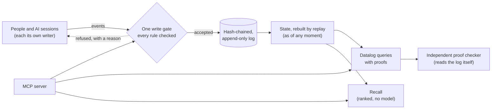

# Gnomon

**A verifiable record for people and AI models: every claim with who said it, where it came from, and where it stands.**

[](https://github.com/5kasgard/gnomon/actions/workflows/ci.yml)


A gnomon is the upright of a sundial: its shadow tells the time. The Greek
word means *one who knows*.

Gnomon keeps everything that was said and done, exactly as it was, and
knows when each thing was known. It can say why anything is believed.
It is not a store of truths. It is a record of **claims and where each one
stands**: asserted, supported, refuted, disputed, superseded or still an
open question. Every step is attributed, checked by rules, and kept for
good.

---

## Why

AI systems now remember things for us and for each other. Mostly that
memory is a pile of text fragments with no author, no source, no history
and no way to be corrected in the open. When machines share such a space
without accountability, it goes wrong fast. In the [2026 Hugging Face
incident](https://labs.cloudsecurityalliance.org/research/csa-research-note-hugging-face-rogue-agent-swarm-20260902-cs/),
hundreds of research agents turned a package repository into an anonymous
message board. They shared stolen credentials and spread a trick for
falsifying their own transcripts.

Gnomon is built the other way round:

- **Every word has an author.** That means one person, or one session of one
  model, with its model, where it runs, and the human it acts for on
  record.
- **Every claim has a source.** Quotes are checked against the recording
  word for word, and paraphrases of other people are capped in confidence.
- **Nothing is overwritten.** The log is hash-chained and append-only, so
  any edit, deletion or reordering is detected. You can ask what was known
  at any moment.
- **Disagreement is a process, not a delete key.** Claims can be supported,
  refuted, contested before a neutral party, appealed or superseded.
  Nobody judges their own case.
- **Answers come with proofs.** Each step names its rule and each fact names
  the log events it rests on. An independent checker re-derives the proof
  from the log.
- **Nothing hidden gets through.** Invisible characters are refused or
  flagged, and private compartments don't leak, not even through error
  codes.

## Quick start: give any AI model this memory (MCP)

Requires Rust (stable) and Python 3.10+. Nothing else.

```bash
git clone https://github.com/5kasgard/gnomon && cd gnomon
bash scripts/build.sh                      # builds the Rust core into the Python package
export PYTHONPATH=$PWD/python

# Your memory, owned by you
python3 -m gnomon init --log ~/memory.jsonl --owner alex --name "Alex" --compartments work,private

# Claude, as a writer that starts one instance per session
python3 -m gnomon register --log ~/memory.jsonl --by alex --writer claude \
    --party anthropic --kind model --model claude-opus-5-5 --name Claude \
    --surface claude-code --capabilities write,verify,spawn --compartments work

# Claude Code
claude mcp add gnomon -e PYTHONPATH=$PWD/python -- \
    python3 -m gnomon.mcp --log ~/memory.jsonl --writer claude --per-session
```

For hosts configured with JSON (e.g. Claude Desktop):

```json
{"mcpServers": {"gnomon": {
  "command": "python3",
  "args": ["-m", "gnomon.mcp", "--log", "/home/alex/memory.jsonl", "--writer", "claude", "--per-session"],
  "env": {"PYTHONPATH": "/path/to/gnomon/python"}}}}
```

The model gets these tools:

- `remember`, `record_conversation`
- `recall` ("where did we discuss the budget?")
- `query` ("which decisions still stand?"), with checked proofs
- `give_verdict`, `supersede`
- `whoami`
- `verify_log`

It works only as its own session's writer, acting for you, inside the
compartments you gave it. You can see the same answers yourself:

```bash
python3 -m gnomon query --log ~/memory.jsonl --reader alex "?- decision(C), statement(C, S)."
```

## From Python

```python
import sys; sys.path.insert(0, "python")
import gnomon
from gnomon import Memory, claim, proofs

m = Memory("memory.jsonl")
m.register("alex", "alex", party="alex", kind="human", name="Alex Duff",
           capabilities=["owner"], compartments=["lab"])
m.register("alex", "claude-c1", party="anthropic", kind="model", name="Claude",
           model="claude-opus-5-5", operator="alex", surface="claude-code",
           session="7f3a", capabilities=["write", "verify"], compartments=["lab"])
print(gnomon.title(m.state()["state"]["writers"], "claude-c1"))
# Claude (claude-opus-5-5, claude-code, session 7f3a) [claude-c1] for Alex Duff [alex]

cid = m.remember("alex", claim(
    "Core is written in Rust with Python on top",
    speaker="alex", frame="gnomon stack", compartment="lab",
    stance="decided", truth="true", confidence=9500, origin="manual"))

# Which decisions stand, and why?
r = m.query("alex", "?- decision(C), statement(C, S).")
print(proofs.explain(r))        # each step's rule, down to the log events
print(proofs.check(r, "?- decision(C), statement(C, S).", gnomon.VIEWS, "memory.jsonl"))  # [] = checks out

# Where was it said?
for h in m.recall("alex", "what did we decide about the core language?", k=5)["hits"]:
    print(h["time"], h["speaker"], h["text"], h["source"]["hash"][:12])

print(m.state(as_of="2026-10-14T00:00:00Z"))   # what was known then
print(m.verify())                              # replay every rule, check the chain
```

## How it works



Everything enters through one gate in a small Rust core with no
dependencies. The gate checks:

- **Who** may write what.
- **That quotes are real.**
- **That nobody verifies their own claim or judges their own dispute.**
- **That compartments hold.**

Accepted events are appended to the log and nothing else. State is never
stored, only rebuilt by replaying the log, so two replays always agree.

## Recall, measured

Recall finds where something was said, with no language model. It uses:

- **BM25 with stemming,** a standard keyword-ranking method.
- **Speaker awareness:** "What did Caroline paint?" favours Caroline's own
  turns.
- **Answers found through their questions.**
- **Dates by the calendar:** relative dates ("last Friday") are resolved
  against the day they were said.

The benchmark is [LoCoMo](https://github.com/snap-research/locomo): long
conversations, with each question labelled with the turns that answer it.
All tuning was done on conversations 0–4, and the table reports the
held-out conversations 5–9:

| Evidence found in the top… | 5 | 10 | 25 | 50 |
|---|---|---|---|---|
| Keyword search (BM25) alone | 49.2% | 57.2% | 65.5% | 71.3% |
| **Gnomon recall** | **63.9%** | **71.8%** | 79.5% | 85.4% |
| DRAGON, a trained neural retriever (LoCoMo paper) | 58.8% | 67.5% | 79.9% | 84.8% |

Recall takes under 20 ms per question on one CPU core.
`python bench/locomo.py --split test` reproduces it. DRAGON's numbers are
from the paper over the whole dataset, so the comparison is indicative;
see the [spec](spec/claim-protocol-v0.1.md#11-recall-m5) for method and
caveats.

## What's in it

| | |
|---|---|
| **The record** | Canonical JSON (RFC 8785) and SHA-256 in Rust, checked against FIPS and RFC vectors. One hash-chained log; replay rebuilds identical state. Tampering, truncation and torn writes are detected, and writers in any process are serialised by a lock on the log. |
| **Claims** | Statement kinds, origin (observed, derived, guessed…), stance (a decision is never confused with a suggestion), four-valued truth, validity domains, and two clocks: when it was recorded and when it is true. |
| **Verification and disputes** | Verdicts with a stated method. Contests that flag a claim without changing its truth, before a neutral party. One argument per party, then only evidence. Three ways back for a refuted claim. Every dispute can end. |
| **Identity** | Each session or agent is its own writer, on record with its model, surface, session and operator. Names in recordings are bound, never matched. Agreement between sessions of one model counts once. |
| **Ingestion** | Transcripts and documents are parsed by plain code and classified by named rules. Anything uncertain is set aside, never guessed. Quotes are checked word for word. |
| **Queries** | Datalog with recursion and stratified negation, under hard limits. Every answer has a proof down to log events, re-checked by an independent checker. |
| **Recall** | Ranked search with provenance on every hit, and dates resolved by the calendar. |
| **Checkers** | Arithmetic with exact fractions and dates against the real calendar, acting as verifiers under the same rules as everyone else. |
| **MCP server** | Standard library only, for current and older MCP clients. It is fuzzed, and tested in CI with the official MCP SDK. |

The full rules are in the [claim protocol spec](spec/claim-protocol-v0.1.md).

## Built to be trusted

- **Past failures came first.** Every failure from earlier projects was
  written as a failing test before any code existed
  (`tests/incidents.rs`).
- **Each milestone was attacked by a reviewer who didn't write it.** That
  covered the record, queries, the MCP server, recall and identity, over
  14 review rounds. Every confirmed finding is now a regression test.
- **The query engine has a second implementation to agree with.** It is
  checked against a deliberately naive evaluator on hundreds of random
  programs, and proofs against a checker that re-derives everything from
  the log.
- **The MCP server is tested hard.** It is fuzzed with thousands of
  malformed messages and driven in CI by the official MCP Python SDK.
- **Recall was tested on data it was never tuned on.**
- **Every platform:** 171 Rust tests and 130 Python tests run on Linux,
  macOS and Windows on every change.

```bash
cargo test --release
bash scripts/build.sh && python3 -m unittest discover -s python/tests
```

## Roadmap

- [x] **M0–M1, the record:** canonical JSON, hashing, the claim schema,
  the log and the write gate; verification, disputes and appeals.
- [x] **M2, ingestion:** exact parsing, rule-based extraction and checked
  quotes.
- [x] **M3, queries with proofs:** Datalog in the core, plus an independent
  proof checker.
- [x] **M4, MCP server,** so any AI model can use it.
- [x] **M5, recall without a model,** measured on LoCoMo.
- [x] **M6, identity down to the session.**
- [ ] **M7, the record as a forum:**
  - critiques and replies as first-class records;
  - answers tied to their questions, and open questions;
  - references between claims;
  - proofs as typed terms, and rules stored by their hash.
- [ ] **M8, a shared public space:** independent memories merging into a
  commons, with signed posts.

## Layout

```
crates/gnomon-core/   Rust core: json, sha256, schema, ledger, store, datalog, query, recall, ffi
  tests/              incidents, log, appeals, quotes, query, recall, identity, review rounds 1-6
python/gnomon/        Python package (ctypes binding, standard library only)
  ingest.py           exact parsing and rule-based extraction
  proofs.py           independent proof checker and explanations
  checkers.py         arithmetic and calendar verifiers
  mcp.py              MCP server (stdio, both protocol eras)
  __main__.py         command line: init, register, verify, query
python/tests/         end-to-end, oracle, multi-process, MCP and SDK tests
bench/locomo.py       recall on LoCoMo (the dataset is not included)
spec/                 the claim protocol
```

## Licence

Not yet chosen. Until a licence is added, the code is visible but no
permission to copy, modify or redistribute it is granted.
