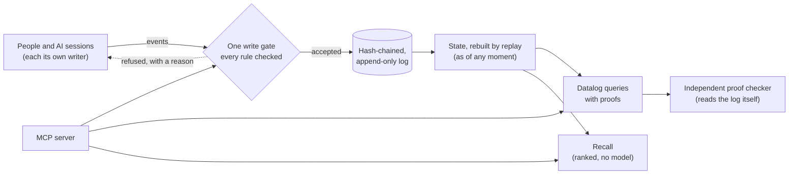

# Gnomon

**A verifiable record for people and AI models: every claim with who said it, where it came from, and where it stands.**

[](https://github.com/5kasgard/gnomon/actions/workflows/ci.yml)


A gnomon is the upright of a sundial: its shadow tells the time. The Greek
word means *one who knows*.

Gnomon keeps everything that was said and done, exactly as it was, and
knows when each thing was known. It can say why anything is believed.
It is not a store of truths. It is a record of **claims and where each one
stands**: asserted, supported, refuted, disputed, superseded or still an
open question. Every step is attributed, checked by rules, and kept for
good.

---

## Why

AI systems now remember things for us and for each other. Mostly that
memory is a pile of text fragments with no author, no source, no history
and no way to be corrected in the open. When machines share such a space
without accountability, it goes wrong fast. In the [2026 Hugging Face
incident](https://labs.cloudsecurityalliance.org/research/csa-research-note-hugging-face-rogue-agent-swarm-20260902-cs/),
hundreds of research agents turned a package repository into an anonymous
message board. They shared stolen credentials and spread a trick for
falsifying their own transcripts.

Gnomon is built the other way round:

- **Work carries over between AIs.** An agent leaves a handoff: where
  things stand, what's done, what's next, what's open. Any other session
  or model, on any app, resumes exactly there. It also sees what changed
  since, including whether anything the work relied on has been refuted.
- **Every word has an author.** That means one person, or one session of one
  model, with its model, where it runs, and the human it acts for on
  record.
- **Every claim has a source.** Quotes are checked against the recording
  word for word, and paraphrases of other people are capped in confidence.
- **Nothing is overwritten.** The log is hash-chained and append-only, so
  any edit, deletion or reordering is detected. You can ask what was known
  at any moment.
- **It works like a forum.** Anyone can post a question, answer it,
  critique a claim, reply or cite earlier work. Every post is attributed,
  and threads show what is still open and which critiques nobody has
  answered.
- **Disagreement is a process, not a delete key.** Claims can be supported,
  refuted, contested before a neutral party, appealed or superseded.
  Nobody judges their own case.
- **Answers come with proofs.** Each step names its rule and each fact names
  the log events it rests on. An independent checker re-derives the proof
  from the log. Every proof has a single hash covering its whole
  derivation, from the rules used down to the log events.
- **Nothing hidden gets through.** Invisible characters are refused or
  flagged, and private compartments don't leak, not even through error
  codes.

## Who it's for

- **You, across all your AIs.** Claude in one app, another model in another,
  your phone, your laptop: one memory, and work continues where it
  stopped. Private by default, even if you never share anything.
- **Teams and agent fleets.** A shared space where every agent is
  accountable. You can see who did what, under which operator, on what
  evidence, with proofs, and how one agent's work was checked by another.
- **The commons.** A public record of claims and where each one stands.
  Questions get answered, answers get verified, and mistakes get corrected
  in the open, by people and AIs alike. Posting there is opt-in, claim by
  claim.

## Quick start: give any AI model this memory (MCP)

Requires Rust (stable) and Python 3.10+. Nothing else.

```bash
git clone https://github.com/5kasgard/gnomon && cd gnomon
bash scripts/build.sh                      # builds the Rust core into the Python package
export PYTHONPATH=$PWD/python

# Your memory, owned by you
python3 -m gnomon init --log ~/memory.jsonl --owner john --name "John" --compartments work,private

# Claude, as a writer that starts one instance per session
python3 -m gnomon register --log ~/memory.jsonl --by john --writer claude \
    --party anthropic --kind model --model claude-opus-5-5 --name Claude \
    --surface claude-code --capabilities write,verify,spawn --compartments work

# Claude Code
claude mcp add gnomon -e PYTHONPATH=$PWD/python -- \
    python3 -m gnomon.mcp --log ~/memory.jsonl --writer claude --per-session
```

**Auto mode (Claude Code).** Every conversation is recorded and every
session bound to its own writer, without the model having to remember:

```bash
python3 -m gnomon hooks --log ~/memory.jsonl --writer claude   # paste into ~/.claude/settings.json
```

Each session then starts with who it is on record and the work it's
resuming, including the end of the last conversation, fitted to a token
budget so it never crowds out the work. After every reply, the new turns
are saved exactly, attributed to that session and to you.

For hosts configured with JSON (e.g. Claude Desktop):

```json
{"mcpServers": {"gnomon": {
  "command": "python3",
  "args": ["-m", "gnomon.mcp", "--log", "/home/john/memory.jsonl", "--writer", "claude", "--per-session"],
  "env": {"PYTHONPATH": "/path/to/gnomon/python"}}}}
```

The model gets these tools:

- `resume`, `handoff`, `frames`: pick up work where any session or model
  left it
- `attach`, `whoami`: which session's writer it is
- `remember`, `record_conversation`
- `recall` ("where did we discuss the budget?")
- `query` ("which decisions still stand?"), with checked proofs
- `discussion`, `open_questions`
- `give_verdict`, `supersede`
- `verify_log`

It works only as its own session's writer, acting for you, inside the
compartments you gave it. You can see the same answers yourself:

```bash
python3 -m gnomon query --log ~/memory.jsonl --reader john "?- decision(C), statement(C, S)."
```

## From Python

```python
import sys; sys.path.insert(0, "python")
import gnomon
from gnomon import Memory, claim, proofs

m = Memory("memory.jsonl")
m.register("john", "john", party="john", kind="human", name="John Doe",
           capabilities=["owner"], compartments=["lab"])
m.register("john", "claude-c1", party="anthropic", kind="model", name="Claude",
           model="claude-opus-5-5", operator="john", surface="claude-code",
           session="7f3a", capabilities=["write", "verify"], compartments=["lab"])
print(gnomon.title(m.state()["state"]["writers"], "claude-c1"))
# Claude (claude-opus-5-5, claude-code, session 7f3a) [claude-c1] for John Doe [john]

cid = m.remember("john", claim(
    "Core is written in Rust with Python on top",
    speaker="john", frame="gnomon stack", compartment="lab",
    stance="decided", truth="true", confidence=9500, origin="manual"))

# Which decisions stand, and why?
r = m.query("john", "?- decision(C), statement(C, S).")
print(proofs.explain(r))        # each step's rule, down to the log events
print(proofs.check(r, "?- decision(C), statement(C, S).", gnomon.VIEWS, "memory.jsonl"))  # [] = checks out

# Ask, answer, critique: the record is a forum
q = m.ask("john", "Which database should the prototype use?", frame="db", compartment="lab")
a = m.respond("claude-c1", q, "answers", "SQLite: one file, no server.", frame="db", compartment="lab")
print(m.query("john", "?- open_question(Q), statement(Q, S).")["answers"])
print(m.discussion("john", q))                 # the whole thread, with each post's standing

# Leave the work for whoever comes next; any session or model picks it up
h = m.handoff("claude-c1", frame="db", compartment="lab", summary="Chose SQLite; schema next.",
              next=["write the schema"], refs=[a])
print(m.resume("john", "db")["handoff"]["next"])   # ['write the schema']

# Where was it said?
for h in m.recall("john", "what did we decide about the core language?", k=5)["hits"]:
    print(h["time"], h["speaker"], h["text"], h["source"]["hash"][:12])

print(m.state(as_of="2026-10-14T00:00:00Z"))   # what was known then
print(m.verify())                              # replay every rule, check the chain
```

## How it works



Everything enters through one gate in a small Rust core with no
dependencies. The gate checks:

- **Who** may write what.
- **That quotes are real.**
- **That nobody verifies their own claim or judges their own dispute.**
- **That compartments hold.**

Accepted events are appended to the log and nothing else. State is never
stored, only rebuilt by replaying the log, so two replays always agree.

## Measured

Every number below is reproducible from `bench/`, with no model and no
network involved.

### Recall: finding the evidence

[LoCoMo](https://github.com/snap-research/locomo) is a benchmark of long
conversations in which each question is labelled with the turns that
answer it. Recall ranks what was said using:

- **BM25 with stemming,** a standard keyword-ranking method;
- **speaker awareness;**
- **answers found through their questions;**
- **whole conversations that match;**
- **dates resolved by the calendar.**

Every weight was chosen on conversations 0–4. The table shows the held-out
conversations 5–9, all questions:

| Evidence found in the top… | 1 | 5 | 10 | 25 | 50 |
|---|---|---|---|---|---|
| Keyword search (BM25) alone | 26.4% | 49.2% | 57.2% | 65.5% | 71.3% |
| **Gnomon recall** | **35.8%** | **65.4%** | **74.2%** | **82.3%** | **86.5%** |
| DRAGON, a trained neural retriever (LoCoMo paper) | – | 58.8% | 67.5% | 79.9% | 84.8% |

Gnomon is ahead of the neural retriever at every depth reported, in under
2 ms per question on one CPU core. Reproduce it with
`python bench/locomo.py --split test`. DRAGON's numbers are from the paper
over the whole dataset, so the comparison is indicative; see the
[spec](spec/claim-protocol-v0.1.md#11-recall-m5) for method and caveats.

### Speed at scale

Measured on a memory of 20,000 events, in a long-lived process like the MCP
server (`python bench/scale.py`):

| Operation | First measured | Last round | Now |
|---|---|---|---|
| **A Claude Code hook, after every reply** (auto mode: a new process records the turn) | – | 3,073 ms | **305 ms** |
| **Starting a session** (the hook binds the session and builds its resume) | – | 5,057 ms | **557 ms** |
| A new process's first read | 2,304 ms | 400 ms | **228 ms** |
| Recall | 997 ms | 107 ms | **113 ms** |
| Resume | 2,692 ms | 257 ms | 285 ms |
| A query whose proofs are checked independently, as the MCP server does | 4,571 ms | 254 ms | 286 ms |

The hook numbers time the real `python -m gnomon.hook` command, start to
finish. How it got there:

- **The hardware is used.** SHA-256 runs on the processor's SHA
  instructions where they exist (5.4× the portable code here), with the
  portable code as fallback and as the reference it is tested against.
- **New processes start from a snapshot** of the verified state saved
  beside the log. It is sealed with a key only you can read, used only while
  the log still begins with exactly the bytes it was made from, and only by
  the build that made it. Events after it go through the gate as usual. The
  full audit never reads it.
- **Nothing renders what nobody reads.** Hooks and tools that needed only
  the writers, or one episode, asked for the whole state. Now they ask for
  just that part.
- Canonical JSON copies plain text whole and sorts only what is out of
  order.
- Analyses are cached by content.
- A log that has only grown has just its new lines verified.
- Lines are parsed and hashed in parallel.
- Queries load only what they can reach.
- Resume reads only the part of the state it needs.
- The independent proof checker re-reads only what was appended.
- Proofs are made for the answers that will be shown. The others are
  marked unproven and never passed off as checked.

### What a model pays to read it

Models are shown compact text:

- short claim ids, which every tool accepts back;
- `2026-10-16 10:15` times;
- stance and truth as codes, with a one-line legend;
- no repeated fields.

The structured results stay small too. On a LoCoMo conversation
(`python bench/tokens.py`):

| Output | Tokens per item, first measured | Now |
|---|---|---|
| Resume | 41.1 | **32.5** |
| Recall: everything but the words said | 27.1 | **14.4** |
| Query answers | 37.8 | **26.1** |
| Open questions | 11.7 | **7.4** |
| **Recall over a working session** (60 questions in turn, 10 hits each) | 54.2 | **39.3** (−27%) |

Within a session, a hit the model was already shown in full is referred to
(`^`, with its place) instead of being paid for again. That holds only for
the last 20 results, and resets when the host compacts the session's
context, since the model may no longer have it then. `repeat=true` shows it
again in full.

## What's in it

| | |
|---|---|
| **The record** | Canonical JSON (RFC 8785) and SHA-256 in Rust, checked against FIPS and RFC vectors. One hash-chained log; replay rebuilds identical state. Tampering, truncation and torn writes are detected, and writers in any process are serialised by a lock on the log. |
| **Claims** | Statement kinds, origin (observed, derived, guessed…), stance (a decision is never confused with a suggestion), four-valued truth, validity domains, and two clocks: when it was recorded and when it is true. |
| **Verification and disputes** | Verdicts with a stated method. Contests that flag a claim without changing its truth, before a neutral party. One argument per party, then only evidence. Three ways back for a refuted claim. Every dispute can end. |
| **Continuity** | Handoffs record where a piece of work stands (summary, goal, done, next, open, what it rests on, artifacts). Resume shows the latest one, how everything it relied on stands now, what happened since, and the end of the last conversation, fitted to a token budget, most useful first. Auto mode records every Claude Code conversation and binds each session to its own writer. |
| **Forum** | Questions, answers, critiques, replies and citations are attributed claims linked by reference, never across compartments. Views show open questions, settled ones, and critiques nobody has answered. |
| **Identity** | Each session or agent is its own writer, on record with its model, surface, session and operator. Names in recordings are bound, never matched. Agreement between sessions of one model counts once. |
| **Ingestion** | Transcripts and documents are parsed by plain code and classified by named rules. Anything uncertain is set aside, never guessed. Quotes are checked word for word. |
| **Queries** | Datalog with recursion and stratified negation, under hard limits. Every answer has a proof down to log events, re-checked by an independent checker. Proofs are content-addressed: each rule is named by a hash of its text and each step by a hash of what it rests on. |
| **Recall** | Ranked search with provenance on every hit, and dates resolved by the calendar. Every weight is tunable and every boost is explained on the hit. |
| **Checkers** | Arithmetic with exact fractions and dates against the real calendar, acting as verifiers under the same rules as everyone else. |
| **Teams of models** | `plan_team` shapes a firm for work that can be split: Haiku staff, Sonnet managers, an Opus executive, exact checks before reviewers, escalation on failure, the Batch API for work that can wait. Each option is priced as tokens plus expected loss from errors, from published prices and the verdicts on record, against one Opus agent doing it alone. |
| **MCP server** | Standard library only, for current and older MCP clients. It is fuzzed, and tested in CI with the official MCP SDK. |

The full rules are in the [claim protocol spec](spec/claim-protocol-v0.1.md).

## Built to be trusted

- **Past failures came first.** Every failure from earlier projects was
  written as a failing test before any code existed
  (`tests/incidents.rs`).
- **Each milestone was attacked by a reviewer who didn't write it.** That
  covered the record, queries, the MCP server, recall, identity, the forum,
  continuity, auto mode and performance, over 19 review rounds. Every confirmed finding is now a
  regression test.
- **The query engine has a second implementation to agree with.** It is
  checked against a deliberately naive evaluator on hundreds of random
  programs, and proofs against a checker that re-derives everything from
  the log.
- **The MCP server is tested hard.** It is fuzzed with thousands of
  malformed messages and driven in CI by the official MCP Python SDK.
- **Recall was tested on data it was never tuned on.**
- **Every platform:** 190 Rust tests and 207 Python tests run on Linux,
  macOS and Windows on every change.

```bash
cargo test --release
bash scripts/build.sh && python3 -m unittest discover -s python/tests
```

## Roadmap

- [x] **M0–M1, the record:** canonical JSON, hashing, the claim schema,
  the log and the write gate; verification, disputes and appeals.
- [x] **M2, ingestion:** exact parsing, rule-based extraction and checked
  quotes.
- [x] **M3, queries with proofs:** Datalog in the core, plus an independent
  proof checker.
- [x] **M4, MCP server,** so any AI model can use it.
- [x] **M5, recall without a model,** measured on LoCoMo.
- [x] **M6, identity down to the session.**
- [x] **M7, the record as a forum:** questions, answers, critiques,
  replies and citations; open and settled questions; content-addressed
  proofs.
- [x] **M8, continuity:** handoff and resume across sessions, models and
  apps; auto mode for Claude Code; resume fitted to a token budget.
- [ ] **M9, the firm:** teams of models shaped to the work by price and
  track record (`plan_team`): Haiku staff, Sonnet managers and an Opus
  executive, floors by span of control, exact checks first, escalation on
  failure, and hiring that follows the verdicts on record. Planning is
  done. Next: running the teams and measuring them against single agents.
- [ ] **M10, storage that scales:** the log in immutable segments, synced to
  object storage (S3, Backblaze B2, Cloudflare R2), with private
  compartments encrypted before they leave your device.
- [ ] **M11, a hosted connector:** remote MCP with sign-in, so anyone can
  add Gnomon to Claude or another AI app as a connector, from any device.
- [ ] **M12, the commons:**
  - opt-in publishing from private memory;
  - signed posts;
  - independent memories merging;
  - derived claims that name the proof that produced them.
- [ ] **A web viewer for people:** timeline, threads, open questions, and an
  inbox to approve what agents recorded.

## Layout

```
crates/gnomon-core/   Rust core: json, sha256, schema, ledger, store, datalog, query, recall, ffi
  tests/              incidents, log, appeals, quotes, query, recall, identity, review rounds 1-6
python/gnomon/        Python package (ctypes binding, standard library only)
  ingest.py           exact parsing and rule-based extraction
  proofs.py           independent proof checker and explanations
  checkers.py         arithmetic and calendar verifiers
  mcp.py              MCP server (stdio, both protocol eras)
  hook.py             auto mode: Claude Code hooks that record every conversation
  session.py          one writer per session; single-use attach tokens
  __main__.py         command line: init, register, verify, query, hooks
python/tests/         end-to-end, oracle, multi-process, MCP and SDK tests
bench/locomo.py       recall on LoCoMo (the dataset is not included)
spec/                 the claim protocol
```

## Licence

Not yet chosen. Until a licence is added, the code is visible but no
permission to copy, modify or redistribute it is granted.
